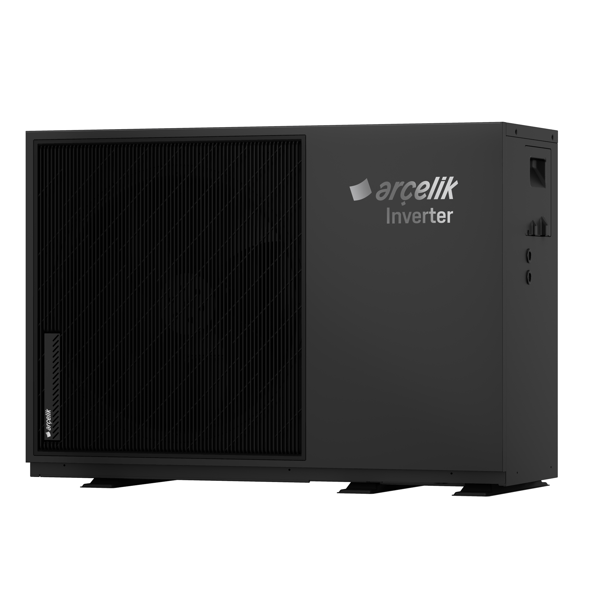

# Tuya Heat Pump - Home Assistant Integration

 ⚠️ **Note:**  
> This integration has only been tested with the heat pump brands listed below.  
> If your heat pump is a different brand and the integration does not work, please run the script at the following link and share the generated file with me:  
> [tuya_api_test.py](https://github.com/Korkuttum/tuya_heat_pump/blob/main/test/tuya_api_test.py)

### Supported Brands
📋 **[Detailed list](https://github.com/Korkuttum/tuya_heat_pump/blob/main/supported_models.md)**

| No | Brand | | No | Brand | | No | Brand |
|---|---|---|---|---|---|---|---|
| 1 | Arçelik (Beko, Grundig) | | 24 | Energie Aquapura Monobloc 270ix | | 47 | MyCond BeeThermic |
| 2 | Alsavo by Zealux | | 25 | EnviroSun HP+ | | 48 | NMT MIA13 |
| 3 | ACIQ | | 26 | Evoheat 40T | | 49 | Poolex Dreamline |
| 4 | Adlar Castra | | 27 | Fairland | | 50 | Poolsana |
| 5 | Adlar Castra Domestic | | 28 | Fairland Inverter Plus | | 51 | Power World |
| 6 | Adlar Fjord Pro | | 29 | GRAT | | 52 | Power World PW030 |
| 7 | Alps Exclusive | | 30 | Heative Next | | 53 | Power World R290 Full DC |
| 8 | Alps Exclusive (f3w5t8 variant) | | 31 | Hogan Calore-NA 8-12 | | 54 | Pure Blue Onyx |
| 9 | Aqua Clear Turbo Silence AXR13 | | 32 | Inventor Xforce | | 55 | Rakentaa |
| 10 | AquaForte Mr. Perfect | | 33 | IPS Pool Systems | | 56 | Reclaim Eco R290 |
| 11 | Aquark | | 34 | ITS | | 57 | Rinnai Enviroflo GR (EHPG280VM) |
| 12 | Aquastrong | | 35 | Ivapool | | 58 | Rotenso |
| 13 | Aquatech X6 | | 36 | Kensol | | 59 | Sannover Stelios 2 |
| 14 | Aquatech X6 320L | | 37 | Klimalife | | 60 | Smad Monobloc 12kW |
| 15 | Argo Apollo 12HP | | 38 | Kushiro (Luqstoff) | | 61 | SolarEast |
| 16 | Climalution -5G | | 39 | Lunna LV LT1530 (Nordic LV LT1530) | | 62 | SolarEast BLN |
| 17 | Cordivari Vestalis | | 40 | Macon/Arctic | | 63 | Swim&Fun Fjord |
| 18 | Della | | 41 | Madimack InverELITE V4 | | 64 | U-Energy |
| 19 | Ecologic Ecopool | | 42 | Mango | | 65 | Water TechniX |
| 20 | Ecolynx | | 43 | Michl SMP0/V2 | | 66 | W'eau |
| 21 | Effecta Air-IQ R290 | | 44 | Mitte Aerotermia | | 67 | W'eau WFI-007 |
| 22 | Effecta Air-IQ V2 | | 45 | Mr. Silent FC25 (Aquara Pool Inverter) | | 68 | Wopoltop |
| 23 | Elterm 18CHW-RMS | | 46 | MyCond BeeHeat |
---

This project allows you to control and monitor your Tuya heat pump device through Home Assistant — supports Cloud, Local (LAN push), and optional real-time MQTT push on top of Cloud mode.

---

## Prerequisites

### Enabling Tuya IoT Cloud Service

To use this integration, you need to create a project in the Tuya IoT Platform, grant API access, and link your device to the project.

**Steps:**

1. Log in to ***[Tuya IoT Platform](https://iot.tuya.com/)***.
2. Go to ***Cloud > Project Management*** and create a new project or select an existing one.
3. Select the ***Devices*** tab:
   - If your devices are already listed, proceed to the next step.
   - If you have no devices yet, open the ***Link App Account*** tab below. Click the ***Add App Account*** button on the right, then select ***Tuya App Account Authorization***. Scan the QR code using your Tuya mobile app and grant permission. Your devices will then appear.
4. Click on the ***Service API*** tab above, then click the ***Go to Authorize*** button and add the following APIs to your project:
   - ***IoT Core***
   - ***Smart Home Basic Service***
   - ***Device Status Notification***
   - ***Authorization Token Management***
5. Retrieve your ***Access ID*** and ***Access Secret*** from the project panel.

> ⚠️ **Important:** The integration will not work without API authorization and device linking.

---

## Installation

### Method 1: Installation via HACS (Recommended)

1. Make sure you have **HACS** installed in your Home Assistant instance.
2. Go to **HACS** → **Integrations**.
3. Click the search icon in the top right and search for **"Tuya Heat Pump"**.
4. Click **Download** on the integration.
5. Restart Home Assistant.

### Method 2: Manual Installation

1. Download the latest release from the [GitHub repository](https://github.com/Korkuttum/tuya_heat_pump).
2. Extract the files and copy the `tuya_heat_pump` folder into your Home Assistant `custom_components` directory.
3. Restart Home Assistant.
---

## Connection Types Compared

| Connection Type | Tuya IoT Account | Local Key | Internet (after setup) | Data Updates | Cloud API Load | Extra Setup |
|---|:---:|:---:|:---:|---|---|---|
| **Local** | ✅ | ✅ | ❌ Not required | Real-time push | None | Device IP + Local Key |
| **Cloud** | ✅ | ❌ | ✅ Required | Poll interval | Regular polling | — |
| **Cloud + MQTT** | ✅ | ❌ | ✅ Required | Real-time push | Minimal | User Code + QR scan |

---

## Configuration

After installation, restart Home Assistant and follow these steps:

1. Go to “Settings > Devices & Services”.
2. Click “Add Integration”.
3. Search for and select “Tuya Heat Pump”.
4. For Cloud mode: enter your Tuya IoT Platform credentials:
    - Access ID
    - Access Secret
    - Device ID
5. For Local mode: switch the Connection Type to “Local” and enter:
    - Device IP
    - Local Key
    - Protocol (e.g. 3.3 / 3.4)
    - Device ID

### Optional: Enabling MQTT (Real-time Push)

On top of Cloud mode, you can optionally enable real-time MQTT push via the Tuya Sharing (Smart Life app) broker — instant state updates instead of waiting on the poll interval, and less load on the Tuya cloud API.

- During setup (Cloud mode), enter your **User Code** and complete the **QR scan** with the Smart Life / Tuya app when prompted.
- This step is entirely optional — skip it and the integration works exactly as before.
- If the push token ever becomes invalid, you'll see a clickable **Repair** notification under *Settings > System > Repairs* to reconnect.

### Optional: Climate (Thermostat) Card

An optional `climate` entity (a Home Assistant thermostat card) for your heat pump — **off by default**, nothing changes for existing setups unless you turn it on yourself.

- Enable it either at the end of initial device setup, or anytime later from the integration's own **Configure → Climate (Thermostat) Card**.
- You pick which of your device's own fields it should use (power switch, current/target temperature, and an optional heat/cool mode field) — every field comes pre-filled with a suggestion based on your device's own data where one is obvious, but stays fully editable and can be left blank.
- Two modes, chosen automatically from what you map:
  - **Direct** — if your device has its own settable target temperature, the card writes straight to it (the device already runs its own closed control loop, the card is just a UI for it).
  - **Virtual** — if it doesn't (most models here are pool heat pumps, where water, not room air, is the controlled value), the card behaves like Home Assistant's own Generic Thermostat: it keeps the target in Home Assistant and drives the power switch itself based on current vs. target, with a configurable tolerance and a minimum on/off cycle duration to protect the compressor from short-cycling.
- Optional cooling support for heat pumps that can both heat and cool through a mode field.

> ⚠️ **Why off by default:** some devices' own Tuya app already runs its own closed-loop room-temperature control internally, and some users have a separate physical/hardware thermostat — in both cases, a second Home Assistant-side control loop on top can fight with the existing one over the same setting. So nothing is created unless you explicitly turn it on and map it yourself.

---

## Notes

- You can monitor and control features like temperature, operation mode, and fan speed.
- Easily use in automations and dashboards.

---

## Diagnostic & Setup Scripts

Standalone scripts for onboarding new devices and debugging — run manually on your own computer, outside Home Assistant. 📖 **[Full guide →](https://github.com/Korkuttum/tuya_heat_pump/blob/main/test/README.md)**

- [`tuya_api_test.py`](https://github.com/Korkuttum/tuya_heat_pump/blob/main/test/tuya_api_test.py) — pulls your device's full cloud schema and live values, start here for any new device.
- [`lokal_key_extractor.py`](https://github.com/Korkuttum/tuya_heat_pump/blob/main/test/lokal_key_extractor.py) — tries to recover your device's Local Key for LAN mode.
- [`tuya_dps_explorer.py`](https://github.com/Korkuttum/tuya_heat_pump/blob/main/test/tuya_dps_explorer.py) — reads raw DP values directly over your local network.
- [`raw_explorer.py`](https://github.com/Korkuttum/tuya_heat_pump/blob/main/test/raw_explorer.py) — live GUI for decoding hidden raw data-points, like a missing target temperature setting.

---

## Support My Work

If you find this integration helpful, consider supporting the development:

## License

This project is licensed under the MIT License - see the [LICENSE](LICENSE) file for details.

## Disclaimer

This integration is an independent project and is not affiliated with, endorsed by, or connected to Tuya Inc. in any way. This is a community project provided "as is" without warranty of any kind. Use at your own risk.
